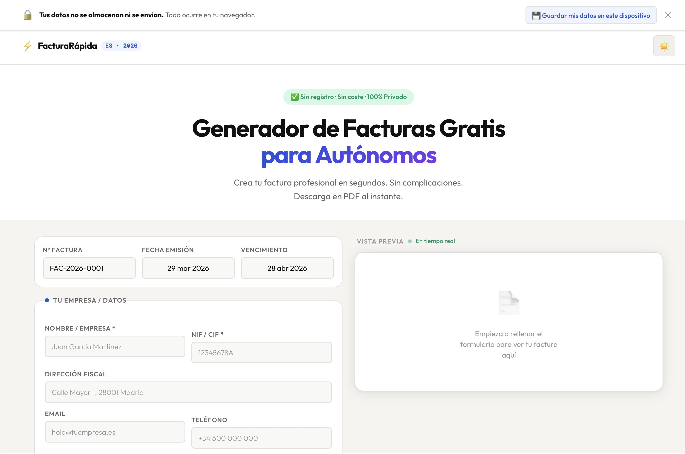

# 🇪🇸 Generador de Facturas para Autónomos (España) – 2026

💻 **Demo Online:** [[Enlace a la app](https://generadordefacturas.vercel.app/)]

---

## ✨ Visión del Proyecto

Generador de facturas online **gratuito, legal y profesional**, pensado para autónomos en España.  
Diseñado para ser **minimalista, intuitivo y eficiente**, inspirado en Notion, Stripe y Linear, pero con identidad propia.  

- **Sin registro, sin servidor**: todo en el navegador, rápido y seguro.  
- **100% legal España 2026**: cumple con Real Decreto 1619/2012.  
- **Optimizado para SEO y social media**: para atraer tráfico orgánico de manera efectiva.  

---

## 🎨 UX/UI – Product Designer

- **Estética:** Refined Minimal, elegante y cálido.  
- **Tipografía:**  
  - Outfit (sans humanist) → textos generales  
  - DM Mono → importes y datos fiscales (sensación de precisión)  
- **Layout split-pane:** Formulario izquierda / Preview derecha, sticky en escritorio. En móvil, el preview se coloca arriba.  
- **Live preview:** con **dot verde animado** que pulsa → feedback inmediato.  
- **Animaciones:** fadeUp escalonadas con cubic-bezier(0.16, 1, 0.3, 1).  
- **Dark mode completo** con toggle y persistencia en localStorage.  
- **Dot de colores por sección:** azul → emisor, ámbar → cliente, verde → conceptos, morado → fiscal.  

---

## ⚙️ Frontend – Ingeniero Senior

- **Stack:** HTML5 + CSS3 + JS vanilla ES6, sin dependencias ni frameworks.  
- **Funciones dinámicas clave:**  
  - Añadir/eliminar líneas con animación lineIn, actualización de totales en tiempo real.  
  - Generación de número de factura correlativo (FAC-2026-0001) → sessionStorage/localStorage.  
  - `printInvoice()` → PDF limpio y profesional, fuentes cargadas antes de imprimir.  
  - `exportJSON()` → JSON estructurado compatible con futura factura electrónica (VeriFactu/B2B2B).  
  - `copyInvoice()` → texto plano al portapapeles con fallback execCommand.  
- **Seguridad:** escapeHtml() en todos los inputs → protección XSS.  
- **Formato monetario español:** Intl.NumberFormat('es-ES').  

---

## 🔍 SEO 2026

| Elemento | Implementación |
|----------|----------------|
| `<title>` | Palabra clave principal + año + intención |
| `<meta description>` | 155 chars persuasivos con CTA implícito |
| Schema | SoftwareApplication + FAQPage con rich snippets |
| Canonical | Evita contenido duplicado |
| Open Graph / Twitter Card | Optimizado para CTR en redes |
| Estructura H1/H2/H3 | Jerarquía semántica perfecta |
| Contenido SEO | Guía + tabla ejemplo + FAQ expandible (`details/summary`) |
| `lang="es"` | Señal geográfica España |

**Keywords objetivo:**  
`generador de facturas gratis`, `crear factura autónomo España`, `hacer factura online sin registro`, `factura electrónica 2026`  

---

## ⚖️ Cumplimiento Fiscal España 2026

Campos obligatorios según RD 1619/2012:  

✅ Número correlativo único  
✅ Fecha de expedición  
✅ NIF emisor y receptor  
✅ Descripción del servicio  
✅ Base imponible  
✅ Tipo y cuota de IVA (21%, 10%, 4%, 0%)  
✅ Retención IRPF (15%, 7%, 0%)  
✅ Total de la factura  
✅ Nota de exención (IVA 0%)  

---

## 💡 Ideas de Monetización

- Banner **“¿Necesitas asesoría fiscal?”** → afiliación gestorías online.  
- **Descarga con logo personalizado** → feature premium (upload client-side).  
- **Plantillas premium** → diseños extra PDF descargables.  
- **Plugin WordPress** → versión embebible.  
- **API pública** → generación de facturas programática para desarrolladores.  

---

## 🛠 Tecnologías & Librerías

- HTML5, CSS3, JS vanilla (ES6)  
- localStorage / sessionStorage  
- Animaciones CSS y cubic-bezier  
- Accessible & responsive layout (móvil y escritorio)  
- No frameworks, no dependencias externas  

---

## 📈 Impacto & Aprendizaje

- Experiencia completa **UX → Frontend → SEO → Fiscal**.  
- Proyecto **100% autónomo**: diseño, desarrollo y optimización.  
- Base sólida para **apps legales y financieras en España**.  
